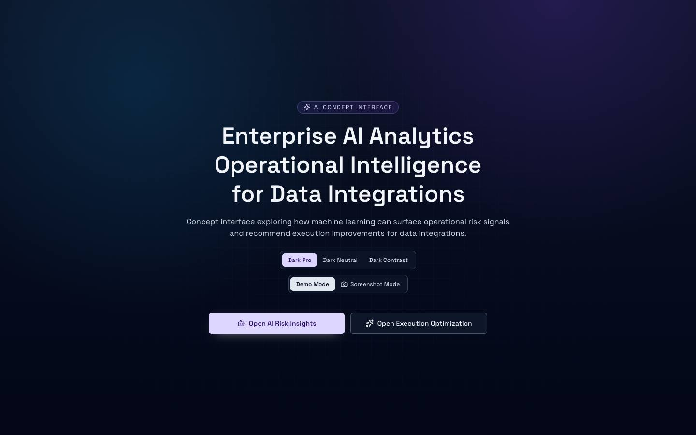
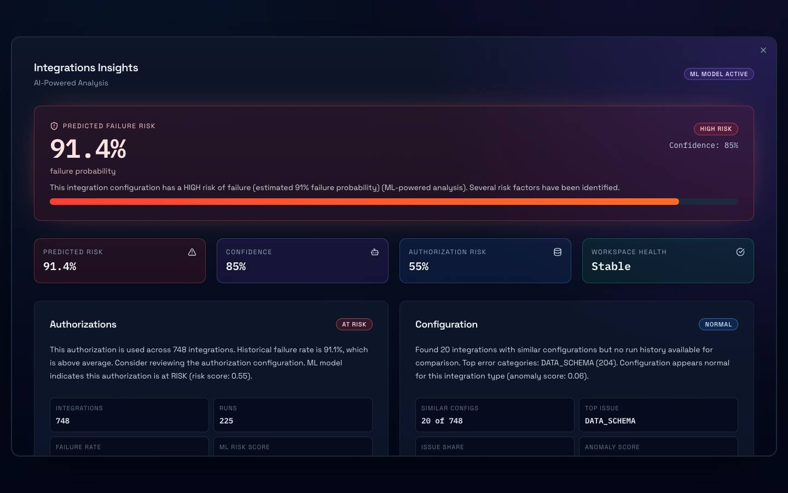
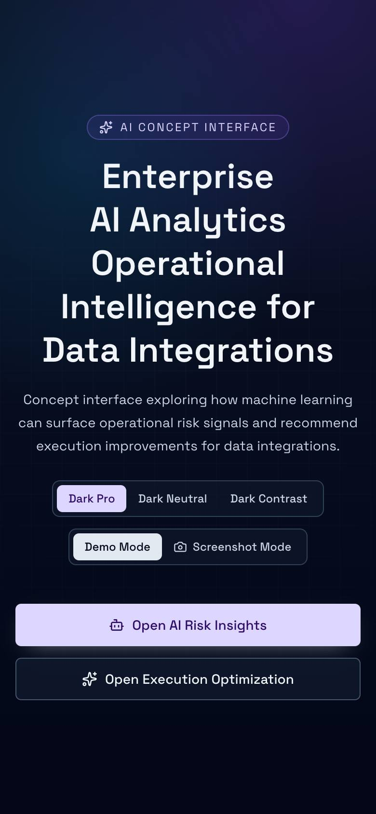

# AI Concept Interface

> A concept interface for enterprise AI analytics — how machine learning could surface operational intelligence (risk, schedules, configuration health) for data integrations.

<p align="center">
  
  
  
</p>

## Built with

React · TypeScript · Tailwind CSS · Vite

## Run locally

```bash
npm install
npm run dev
```

## License

Released under the [MIT License](LICENSE).
